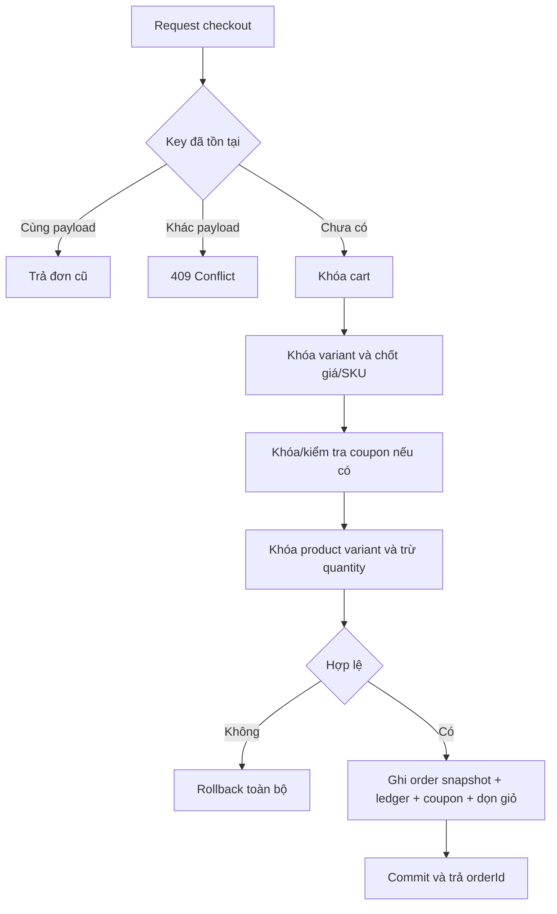

# Luồng nghiệp vụ và trạng thái

Các luồng là thiết kế đề xuất, cần được nhóm chốt và thống nhất trước khi triển khai. Quyền ở đây bổ sung kiểm tra role, không thay kiểm tra ownership.

## Checkout

1. USER gửi addressId, paymentMethod, couponCode tùy chọn và Idempotency-Key; actorId lấy từ principal. ERD không có cột note trong `orders`.
2. Order kiểm tra key cũ trước; khóa cart và lấy items cần mua; từ chối giỏ trống.
3. User service kiểm tra địa chỉ thuộc khách. Catalog khóa các variant theo ID tăng dần và trả snapshot gồm product/variant name, SKU, giá và trạng thái đang bán.
4. Promotion khóa coupon nếu có, kiểm tra điều kiện bằng snapshot và tính subtotal, discount, shippingFee, total tại server; MVP shippingFee = 0. Tổng không âm; không nhận tổng từ client.
5. Tạo Order PENDING để có orderId trong transaction. Inventory dùng contract catalog để khóa `product_variants` theo ID tăng dần, kiểm tra `quantity` và giảm tồn. Nếu thiếu, trả 409 `INSUFFICIENT_STOCK` và rollback.
6. Inventory append SALE movement gắn orderId; order hoàn tất items/snapshot/history; promotion ghi usage; cart xóa mục đã mua. Mọi việc trong cùng transaction; order tạo sớm cũng rollback nếu bước sau thất bại.
7. Commit rồi trả order. COD chờ xác nhận/giao; online mở payment session bằng request khác. Checkout lỗi ở bất kỳ bước nào rollback toàn bộ.

## Trạng thái order

| Từ | Đến | Ai và điều kiện | Tác động |
|---|---|---|---|
| PENDING | CONFIRMED | STAFF/ADMIN; online phải PAID | History; không trừ tồn thêm |
| PENDING_PAYMENT | CANCELLED | Chủ đơn hoặc STAFF/ADMIN khi chờ thanh toán | Hoàn tồn/coupon một lần |
| WAITING_CONFIRMATION | CANCELLED | STAFF/ADMIN, bao gồm duyệt yêu cầu hủy COD | Hoàn tồn/coupon một lần |
| CONFIRMED | PACKING | STAFF/ADMIN | History |
| CONFIRMED | CANCELLED | STAFF/ADMIN, chưa bàn giao; online chưa PAID | Hoàn tồn/coupon một lần |
| PACKING | SHIPPING | STAFF/ADMIN | Ghi thông tin bàn giao |
| PACKING | CANCELLED | STAFF/ADMIN duyệt yêu cầu hủy COD | Hoàn tồn/coupon một lần |
| SHIPPING | DELIVERED | STAFF/ADMIN xác nhận giao | Không đổi stock; COD thu tiền là bước payment riêng |
| SHIPPING | DELIVERY_FAILED | STAFF/ADMIN | Giữ tồn đã trừ |
| DELIVERY_FAILED | SHIPPING | STAFF/ADMIN giao lại | Không đổi stock |
| DELIVERY_FAILED | CANCELLED | STAFF/ADMIN; xác nhận hàng đã về kho và online chưa PAID | Hoàn tồn/coupon đúng một lần |

Chủ đơn COD có thể yêu cầu hủy ở `WAITING_CONFIRMATION`, `CONFIRMED` và `PACKING`. Đơn giữ trạng thái hiện tại và tạm dừng xử lý trong lúc chờ duyệt. Khi duyệt, hệ thống ghi người duyệt và lý do của khách vào lịch sử trạng thái. Mỗi lần chuyển lưu `from_status`, `to_status`, `changed_by_user_id`, `changed_at` và `note` nếu có.

## Hủy và payment callback đồng thời

Hủy khóa order, đọc trạng thái từ `payments` nếu có rồi chuyển CANCELLED, release coupon và gọi inventory restore đúng một lần. Callback khóa payment rồi order. Nếu payment đã PAID, hủy online bị chặn. Nếu hủy commit trước, callback vẫn lưu transaction nhận được nhưng không hồi sinh order đã CANCELLED; trường hợp cần đối soát phải được xử lý ở service vì ERD không có cột `reconciliation_status`.

## Thanh toán

Module thanh toán quản lý trạng thái như PENDING/PAID/FAILED trong `payments`. `orders.payment_method` ghi lại phương thức khách đã chọn lúc đặt hàng. COD cập nhật `payments.status` khi thu tiền.

Online: payment kiểm tra order và số tiền → tạo attempt PENDING có idempotency key → commit → gọi provider/mô phỏng ngoài transaction → callback xác minh → ghi kết quả và thông báo order service trong cùng transaction. Callback FAILED lặp hoặc đến sau PAID không làm PAID lùi về FAILED. Payment attempt thứ hai thành công phải giữ record và đưa vào đối soát thay vì ghi đè lịch sử.

Chủ đơn có thanh toán PAID gửi yêu cầu hoàn toàn bộ số tiền đã thanh toán, kèm lý do và ảnh minh chứng nếu có. Khi ADMIN duyệt, hệ thống cộng tiền vào ví StoreCredit của chủ đơn và ghi giao dịch trong cùng transaction. Khách theo dõi kết quả trong chi tiết đơn và dùng số dư để thanh toán toàn bộ đơn mới.

Với đơn `DELIVERED`, ADMIN xem lý do và ảnh minh chứng của yêu cầu đang chờ. Khi xác nhận đã nhận lại hàng, hệ thống ghi `RETURNED`, nhập lại kho và cộng StoreCredit trong cùng transaction. Khi từ chối, lý do được lưu trên yêu cầu và đơn vẫn ở `DELIVERED`.

Checkout bằng StoreCredit trừ số tiền cuối cùng sau mã giảm giá, ghi giao dịch và tạo payment PAID. Đơn bắt đầu ở CONFIRMED. Nếu số dư thiếu, checkout rollback đơn hàng, tồn kho, coupon và giỏ hàng. Khi một yêu cầu hoàn tiền đã duyệt theo quy trình cũ, hệ thống giữ nguyên kết quả và lịch sử.

## Nhập hàng

STAFF/ADMIN tạo phiếu DRAFT cho supplier và các variant. Khi nhận: khóa phiếu → xác minh DRAFT → inventory khóa các `product_variants`, tăng quantity và ghi PURCHASE_RECEIPT → cập nhật `received_quantity`/trạng thái phiếu → commit. Gọi receive lặp không được cộng tồn lần hai. DRAFT có thể CANCELLED; RECEIVED không chỉnh sửa trực tiếp. Một dòng lỗi rollback cả phiếu.

## Coupon và review

Coupon preview không giữ lượt. Checkout kiểm tra lại dưới khóa và reserve usage; hủy hợp lệ chuyển usage RELEASED một lần. Review chỉ tạo khi order item thuộc actor và đơn DELIVERED; unique order_item_id bảo vệ hai request đồng thời. Review không quyết định lại trạng thái đơn.
