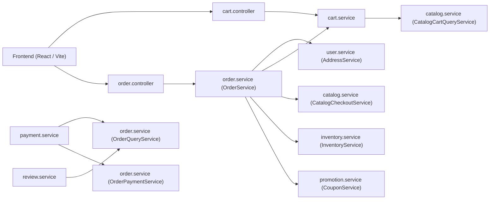
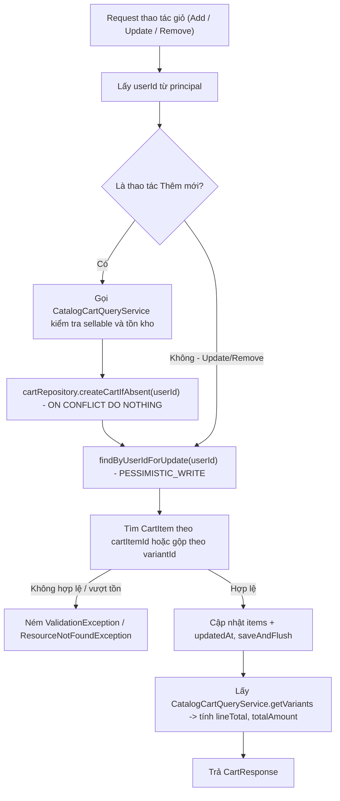
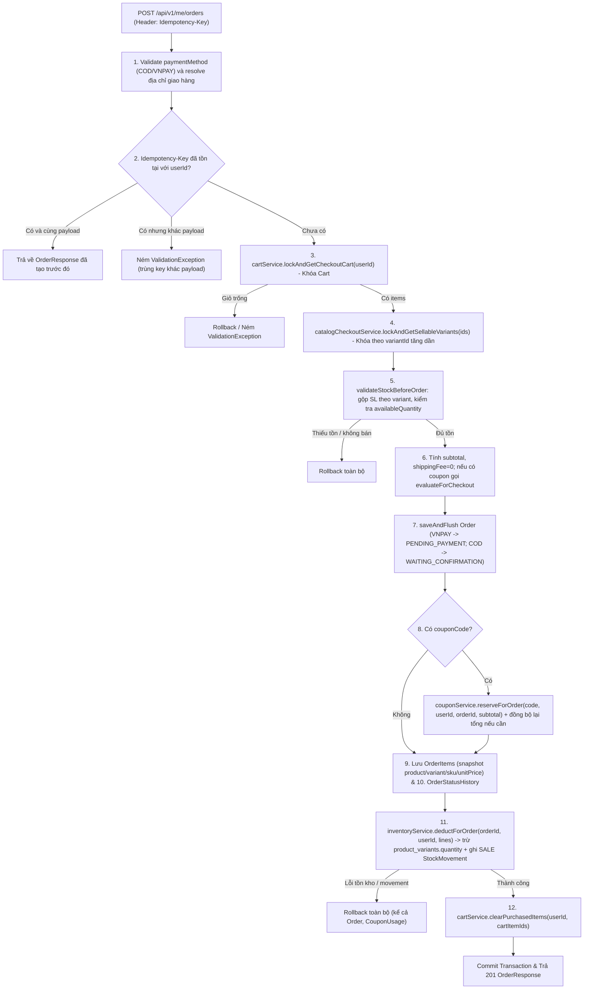
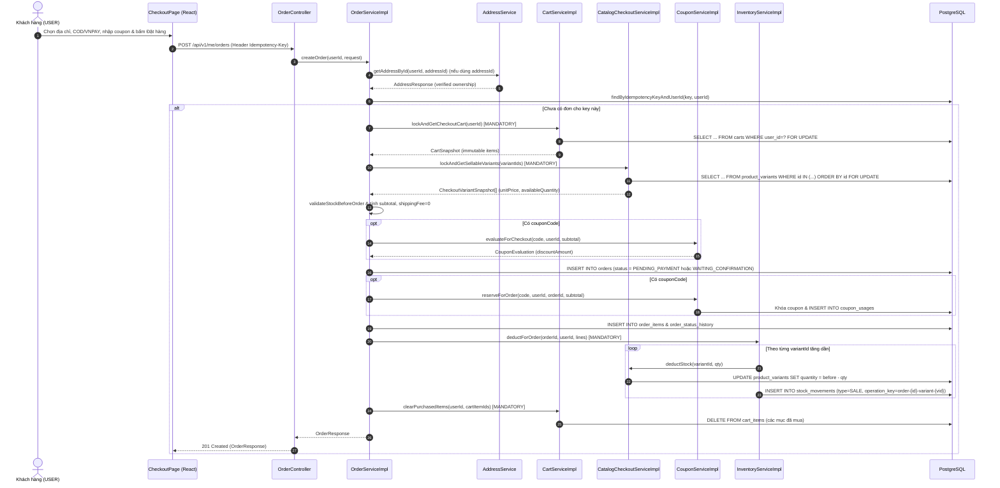
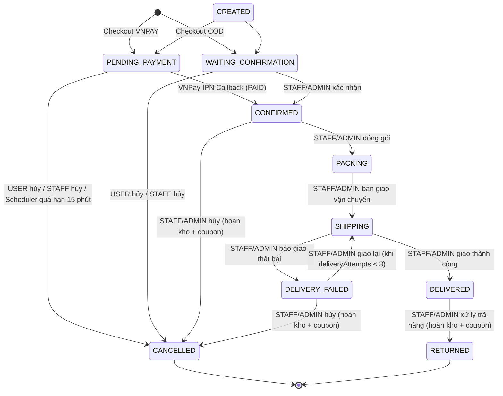
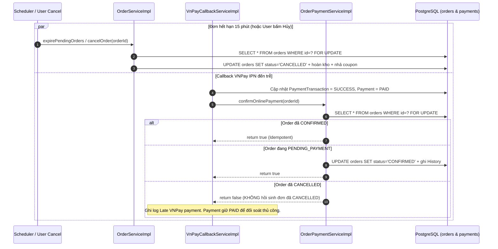

# Tổng Hợp Tri Thức Nghiệp Vụ: Giỏ Hàng, Checkout và Đơn Hàng (`cart` & `order`)

> **Phạm vi:** Tổng hợp từ tài liệu kiến trúc (`backend/docs/architecture/*`), báo cáo tiến độ (`README_KHANG_Tuan4.md`), README module và mã nguồn Backend/Frontend hiện có của dự án **LaptopStore**.  
> **Owner phụ trách:** Phan Anh Khang (vị trí **C** theo `backend/docs/phan_chia_cong_viec.md` và `03-ownership.md`).

---

## 1. Kiến trúc tổng thể & Ranh giới phụ thuộc

### 1.1. Quyền sở hữu dữ liệu (Data Ownership)

| Module | Bảng sở hữu | Quy tắc ghi & giao tiếp |
|---|---|---|
| `cart` | `carts`, `cart_items` | Chỉ `cart` ghi trực tiếp; `order` gọi `CartService` trong transaction checkout. |
| `order` | `orders`, `order_items`, `order_status_history` | Chỉ `order` ghi trực tiếp; `payment` chỉ thông báo kết quả xác minh qua `OrderPaymentService`. |

### 1.2. Đồ thị phụ thuộc (Module Dependency Allowlist)

Theo `backend/docs/architecture/04-dependencies.md` và được kiểm tra tự động bằng ArchUnit (`ModuleArchitectureTest`, `CartArchitectureTest`):

**Bất biến kiến trúc bắt buộc:**
- **Cấm phụ thuộc vòng:** `order` **không** được gọi `payment` hoặc `review`; `cart` **không** được gọi `order`; `catalog` **không** được gọi `inventory`.
- **Không chia sẻ Entity/Repository xuyên module:** Quan hệ JPA (`@OneToMany`, `@ManyToOne`) chỉ dùng bên trong cùng module (ví dụ `Cart` ↔ `CartItem`, `Order` ↔ `OrderItem`, `Order` ↔ `OrderStatusHistory`). Tham chiếu sang module khác (`userId`, `productId`, `variantId`) chỉ lưu ID thuần (`Long`) dù DB có Foreign Key.
- **Controller không chạm Repository/Entity nghiệp vụ:** Mọi transaction và kiểm tra ownership nằm ở tầng Service; `actorId` luôn lấy từ `@AuthenticationPrincipal CustomUserDetails`, không tin `userId` hoặc tiền từ client.

---

## 2. Mô hình dữ liệu & Bất biến lưu trữ

### 2.1. Nhóm Giỏ hàng (`carts`, `cart_items`)

- **`carts`**: `id`, `user_id` (`FK -> users.id`, **UQ `uk_carts_user_id`**), `created_at`, `updated_at`.
  - Mỗi user có tối đa **1 giỏ hàng**.
- **`cart_items`**: `id`, `cart_id` (`FK -> carts.id`), `variant_id` (`FK -> product_variants.id`), `quantity`, `created_at`, `updated_at`.
  - ERD và migration V1 **không** đặt `UNIQUE (cart_id, variant_id)`; tầng service (`CartServiceImpl`) phải khóa dòng `Cart` và tự gộp `quantity` nếu cùng `variantId`.
  - Giỏ hàng **không lưu giá** và **không giữ tồn kho**; giá hiển thị được lấy động từ `CatalogCartQueryService`.

### 2.2. Nhóm Đơn hàng (`orders`, `order_items`, `order_status_history`)

- **`orders`**:
  - Định danh & khóa duy nhất: `id`, `user_id` (`FK -> users.id`), `order_code` (**UQ**), `UNIQUE (user_id, idempotency_key)` (cập nhật qua migration `V8__scope_order_idempotency_key_to_user.sql`, đồng bộ với `findByIdempotencyKeyAndUserId`).
  - Trạng thái & tiền tệ: `status` (`OrderStatus` lưu `STRING`), `subtotal`, `discount_amount`, `shipping_fee`, `total_amount` (`BigDecimal`).
  - Snapshot giao hàng & khuyến mãi: `recipient_name`, `recipient_phone`, `shipping_address`, `coupon_code_snapshot`.
  - Dấu thời gian: `created_at`, `updated_at`.
  - *Lưu ý ERD:* Bảng `orders` **không có** cột `payment_method`, `payment_status`, `request_hash` hay `note`. Thông tin phương thức/trạng thái thanh toán nằm ở bảng `payments` (module `payment`).
- **`order_items`**:
  - `id`, `order_id` (`FK -> orders.id`), `product_id`, `variant_id`, `product_name`, `variant_name`, `sku`, `unit_price`, `quantity`.
  - Snapshot toàn bộ tên sản phẩm, tên biến thể, SKU và đơn giá tại thời điểm checkout để dữ liệu đơn không biến động khi catalog sửa giá/tên.
  - *Lưu ý ERD:* Không có cột `line_total` hay timestamps; thành tiền dòng tính bằng `unit_price * quantity`.
- **`order_status_history`**:
  - `id`, `order_id` (`FK -> orders.id`), `from_status`, `to_status`, `changed_at`, `changed_by_user_id` (`FK -> users.id`, cho phép `null` khi hệ thống tự động hủy hết hạn hoặc callback thanh toán).
  - *Lưu ý ERD:* Không có cột `reason` trong bảng lịch sử.
  - Migration `V6__normalize_order_packing_status.sql` chuẩn hóa dữ liệu cũ `PACKED` thành `PACKING` trên cả `orders` và `order_status_history`.

---

## 3. Nghiệp vụ Giỏ hàng (`cart`)

### 3.1. Danh sách API (`CartController` — `/api/v1/me/cart`)

Tất cả endpoint yêu cầu đăng nhập và lấy `userId` từ `CustomUserDetails`:

| Method & Path | Chức năng | Ghi chú nghiệp vụ |
|---|---|---|
| `GET /api/v1/me/cart` | Xem giỏ hàng hiện tại | Trả `200 CartResponse`; nếu user chưa có cart trong DB thì trả giỏ rỗng tạm thời (`id = null`). |
| `POST /api/v1/me/cart/items` | Thêm sản phẩm vào giỏ | Trả `201 CartResponse`; kiểm tra `quantity > 0`, `variant.isSellable()`, `quantity <= stock`; nếu đã có `variantId` trong giỏ thì cộng dồn và kiểm tra tổng không vượt `stock` (dùng `Math.addExact`). |
| `PATCH /api/v1/me/cart/items/{cartItemId}` | Cập nhật số lượng dòng giỏ | Trả `200 CartResponse`; dùng `cartItemId` (không dùng `variantId`), kiểm tra `sellable` và `stock`, `saveAndFlush` ngay. |
| `DELETE /api/v1/me/cart/items/{cartItemId}` | Xóa 1 dòng khỏi giỏ | Trả `204 No Content`; nếu `cartItemId` không thuộc giỏ của user trả `404`. |
| `DELETE /api/v1/me/cart/items/clear` | Dọn sạch toàn bộ giỏ | Trả `204 No Content`; trong `CartServiceImpl.clearCart` khóa `Cart` bằng `lockedCart(userId)` rồi `clear()`. |

### 3.2. Cơ chế đồng bộ & khóa khi thao tác giỏ

### 3.3. Hợp đồng nội bộ cho Checkout (`CartService`)

- `lockAndGetCheckoutCart(Long userId)`:
  - Annotated `@Transactional(propagation = Propagation.MANDATORY)` (bắt buộc chạy trong transaction của `OrderService`).
  - Khóa hàng `Cart` bằng `PESSIMISTIC_WRITE` (`findByUserIdForUpdate`) để chặn thao tác thêm/sửa/xóa giỏ song song lúc đang tạo đơn.
  - Từ chối nếu chưa có giỏ (`404`) hoặc giỏ rỗng (`ValidationException`).
  - Trả về `CartSnapshot(cartId, userId, items)` **bất biến** (`List.copyOf`).
- `clearPurchasedItems(Long userId, Collection<Long> cartItemIds)`:
  - Annotated `@Transactional(propagation = Propagation.MANDATORY)`.
  - Khóa giỏ, xác minh **toàn bộ** `cartItemIds` thuộc về đúng giỏ của `userId` trước khi xóa (chỉ xóa những mục đã checkout, giữ nguyên nếu có lỗi `ResourceNotFoundException`).

---

## 4. Nghiệp vụ Checkout & Xem trước (`order`)

### 4.1. API Xem trước Checkout (`POST /api/v1/me/orders/preview`)

- Chạy trong `@Transactional(readOnly = true)`, **tuyệt đối không ghi DB** và **không giữ lượt coupon**.
- Luồng xử lý (`OrderServiceImpl.previewCheckout`):
  1. Chuẩn hóa `CheckoutPaymentMethod` (`COD`, `VNPAY`/`ONLINE`; mặc định `COD` nếu bỏ trống).
  2. Nếu có `addressId`, gọi `AddressService.getAddressById(userId, addressId)` kiểm tra ownership và ghép chuỗi `street, ward, district, city, postalCode` (ưu tiên giá trị override từ request nếu có).
  3. Đọc giỏ hàng hiện tại (`cartService.getCart(userId)`), từ chối nếu giỏ trống.
  4. Gọi `CatalogCheckoutService.getSellableVariants(variantIds)` (đọc không khóa) và kiểm tra `validateStockBeforeOrder` (gộp số lượng theo `variantId`, kiểm tra `unitPrice >= 0`, `requestedQty <= availableQuantity`).
  5. Tính `subtotal = sum(unitPrice * quantity)`, `shippingFee = 0` (MVP).
  6. Nếu có `couponCode`, gọi `CouponService.evaluateForCheckout(code, userId, subtotal)` để tính `discountAmount` (chặn không vượt `subtotal`).
  7. Tính `totalAmount = subtotal - discount + shippingFee` (bắt buộc `>= 0`) và trả về `CheckoutPreviewResponse`.

### 4.2. Luồng Tạo đơn hàng chính thức (`POST /api/v1/me/orders`)

Toàn bộ luồng `OrderServiceImpl.createOrder` nằm trong **1 transaction duy nhất (`@Transactional`)** với thứ tự khóa ổn định để **chống Deadlock** và **đảm bảo Atomic Rollback**:

> **Thứ tự khóa chuẩn:** `Cart (PESSIMISTIC_WRITE)` → `ProductVariants theo ID tăng dần (PESSIMISTIC_WRITE)` → `Coupon (khi reserve)` → `Inventory deduct + StockMovement` → `Clear Cart`.

### 4.3. Biểu đồ tuần tự Checkout & Trừ kho (`sequenceDiagram`)

---

## 5. Vòng đời & Máy trạng thái Đơn hàng (`OrderStateMachine`)

### 5.1. Tập trạng thái (`OrderStatus`)

Hệ thống sử dụng 10 trạng thái trong `OrderStatus.java`:
- Khởi tạo / Chờ xử lý: `CREATED`, `PENDING_PAYMENT` (online VNPAY), `WAITING_CONFIRMATION` (COD).
- Đang xử lý & giao vận: `CONFIRMED`, `PACKING`, `SHIPPING`, `DELIVERY_FAILED`.
- Trạng thái kết thúc / hoàn tất: `DELIVERED`, `CANCELLED`, `RETURNED`.

### 5.2. Sơ đồ chuyển trạng thái (`stateDiagram-v2`)

### 5.3. Quy tắc chuyển trạng thái & Phân quyền (`OrderStateMachine` & `OrderServiceImpl`)

| Chuyển trạng thái | Ai được phép | Điều kiện & Ràng buộc | Tác động hệ thống |
|---|---|---|---|
| `PENDING_PAYMENT` → `CONFIRMED` | Hệ thống (`OrderPaymentService`) | **Cấm** STAFF gọi `PUT /staff/orders/{id}/status` chuyển tay; bắt buộc qua callback xác minh thanh toán online. | Ghi `OrderStatusHistory` (`changedByUserId = null`). |
| `WAITING_CONFIRMATION` → `CONFIRMED` | `STAFF` / `ADMIN` | Đơn COD chờ xác nhận. | Ghi `OrderStatusHistory`. |
| `PENDING_PAYMENT` / `WAITING_CONFIRMATION` → `CANCELLED` | Chủ đơn (`USER`) hoặc `STAFF`/`ADMIN` | USER chỉ được hủy khi ở 2 trạng thái này; lặp lệnh hủy trả đơn hiện tại (idempotent). | Ghi history + `restoreForOrder` (`CANCEL_RESTORE`) + `releaseForOrder`. |
| `CONFIRMED` → `PACKING` → `SHIPPING` | `STAFF` / `ADMIN` | Chỉ đi đúng bước kế tiếp trong `VALID_TRANSITIONS`. | Ghi `OrderStatusHistory`. |
| `CONFIRMED` / `DELIVERY_FAILED` → `CANCELLED` | `STAFF` / `ADMIN` | USER không được hủy ở các trạng thái này. | Ghi history + hoàn tồn kho + nhả coupon 1 lần. |
| `DELIVERY_FAILED` → `SHIPPING` | `STAFF` / `ADMIN` | Đếm số lần `toStatus == DELIVERY_FAILED` trong lịch sử; nếu `deliveryAttempts >= 3` thì chặn giao lại. | Ghi `OrderStatusHistory`. |
| `DELIVERED` → `RETURNED` | `STAFF` / `ADMIN` | Xử lý trả hàng sau giao. | Ghi history + `restoreForOrder` + `releaseForOrder`. |
| Trạng thái nguồn == Trạng thái đích | `STAFF` / `ADMIN` | Khi gọi `updateOrderStatus` lặp cùng trạng thái hiện tại. | Idempotent: trả `OrderResponse` hiện tại, không ghi thêm history/hoàn kho. |

---

## 6. Luồng Hủy đơn, Hoàn kho, Thanh toán VNPay & Tự động hết hạn

### 6.1. Cơ chế hoàn kho & nhả coupon khi hủy/trả (`handleOrderCancellationSideEffects`)

Khi chuyển sang `CANCELLED` (từ `cancelOrder`, `updateOrderStatus`, hoặc `expirePendingOrders`) hoặc `RETURNED` (từ `updateOrderStatus`), `OrderServiceImpl` thực hiện trong cùng transaction sau khi khóa `Order` bằng `findByIdForUpdate`:
1. Gọi `InventoryService.restoreForOrder(orderId, actorId, lines)`:
   - Sắp xếp theo `variantId` tăng dần.
   - Dùng `operationKey = "restore-" + orderId + "-variant-" + variantId` (unique toàn cục trong `stock_movements`) để đảm bảo **không bao giờ hoàn tồn kho 2 lần** cho cùng 1 đơn.
   - Cộng lại `product_variants.quantity` qua `CatalogCheckoutService.adjustStock` và ghi `StockMovement` loại `CANCEL_RESTORE`.
2. Nếu đơn có `couponCodeSnapshot`, gọi `CouponService.releaseForOrder(orderId)` (hàm idempotent, chuyển `CouponUsage` sang `RELEASED` một lần).

### 6.2. Tự động hủy đơn chưa thanh toán quá hạn (`OrderExpirationScheduler`)

- `OrderExpirationScheduler.scanAndExpirePendingOrders()` chạy định kỳ mỗi **60 giây** (`@Scheduled(fixedDelayString = "${app.order.expire-check-interval-ms:60000}")`).
- Gọi `OrderService.expirePendingOrders()` với timeout mặc định **15 phút** (`Duration.ofMinutes(15)`).
- Truy vấn `findByStatusAndCreatedAtBefore(OrderStatus.PENDING_PAYMENT, cutoffTime)` kèm khóa `PESSIMISTIC_WRITE` (`ORDER BY o.id`).
- Chuyển từng đơn sang `CANCELLED`, ghi `OrderStatusHistory` (`changedByUserId = null`), hoàn tồn kho và nhả coupon trong cùng `@Transactional`. Lỗi ở bất kỳ đơn nào sẽ rollback toàn bộ batch và đẩy ngoại lệ ra ngoài.

### 6.3. Tranh chấp (Race Condition) giữa Hủy/Hết hạn và VNPay Callback

### 6.4. Hợp đồng truy vấn từ Order sang Payment & Review (`OrderQueryService`)

Module `payment` và `review` không đọc `OrderRepository` trực tiếp mà gọi qua `OrderQueryService`:
- Phục vụ `payment`: `validateOrderOwner`, `validateOrderForOnlinePayment`, `validateOrderForCodPayment`, `getOrderTotalAmount`, `getOnlinePaymentDeadline` (`createdAt + 15 phút`), `validateOrderDelivered` (dùng khi staff ghi nhận đã thu COD).
- Phục vụ `review`: `getOrderItemForReview`, `getOrderItemsForReview` (batch fetch chống N+1), `getOrderItemIdsByProduct`, `getOrderItemIdsByUser`.

---

## 7. Tích hợp Frontend (`frontend/src/modules/cart` & `order`)

| Màn hình / Route | File nguồn chính | Chức năng & luồng gọi API |
|---|---|---|
| Giỏ hàng (`/cart`) | `CartPage.tsx`, `cartApi.ts`, `CartProvider.tsx` | Hiển thị danh sách item kèm ảnh từ `useSkuProducts`, tăng/giảm số lượng (`PATCH /me/cart/items/{cartItemId}`), xóa item (`DELETE`), hiển thị tạm tính và chuyển sang `/checkout`. |
| Checkout (`/checkout`) | `CheckoutPage.tsx`, `orderApi.ts` | 4 bước UI: (1) Chọn địa chỉ đã lưu hoặc nhập mới; (2) Chọn `COD`/`VNPAY`; (3) Nhập coupon & gọi `POST /me/orders/preview`; (4) Xem tổng hợp tiền và bấm đặt hàng (`POST /me/orders` kèm header `Idempotency-Key` tự sinh theo phiên form, reset key khi preview lại). Sau khi đặt thành công, làm mới giỏ (`refreshCart`) và điều hướng `/orders/:id`. |
| Lịch sử đơn hàng (`/orders`) | `OrderHistoryPage.tsx` | Gọi `GET /me/orders`, lọc client-side theo nhóm trạng thái (`Tất cả`, `Chờ xử lý`, `Đang giao`, `Đã giao`, `Đã hủy`). |
| Chi tiết đơn (`/orders/:orderId`) | `OrderDetailPage.tsx` | Gọi `GET /me/orders/{orderId}`, hiển thị timeline 5 chặng (`WAITING_CONFIRMATION` → `CONFIRMED` → `PACKING` → `SHIPPING` → `DELIVERED`), thông tin giao nhận và bảng kê tiền. |
| Quản lý đơn hàng Staff (`/staff/orders`) | `StaffOrderListPage.tsx` | Gọi `GET /staff/orders`, `GET /staff/orders/{orderId}`, lọc/tìm kiếm theo mã đơn hoặc tên người nhận, cập nhật bước chuyển trạng thái hợp lệ (`PUT /staff/orders/{orderId}/status`) khớp `OrderStateMachine.VALID_TRANSITIONS`. |

---

## 8. Đối chiếu & Ghi chú đồng bộ giữa Tài liệu kiến trúc và Code hiện tại

Trong quá trình tổng hợp cho thấy code thực tế đã phát triển chi tiết hơn một số điểm so với bản đề xuất ban đầu trong `06-business-flows.md` và `07-api-contracts.md`:

1. **Trạng thái khởi tạo đơn hàng:**
   - Tài liệu `06-business-flows.md` dùng tên chung `PENDING`, trong khi code thực tế (`OrderStatus`, `OrderServiceImpl`, `OrderStateMachine`) đã tách rõ thành **`PENDING_PAYMENT`** (cho VNPAY) và **`WAITING_CONFIRMATION`** (cho COD), đồng thời bổ sung trạng thái **`RETURNED`**.
2. **Endpoint & HTTP Method quản lý đơn:**
   - Tài liệu `07-api-contracts.md` đề xuất `PATCH /api/v1/staff/orders/{id}/status`, trong khi `OrderController` thực tế đang dùng **`PUT /api/v1/staff/orders/{orderId}/status`**.
   - `OrderController` đã mở thêm **`POST /api/v1/me/orders/preview`** và **`GET /api/v1/staff/orders/{orderId}`**.
3. **Xử lý `note` và `reason`:**
   - `CreateOrderRequest` có field `note`, `UpdateOrderStatusRequest` có field `note`, và `POST /me/orders/{orderId}/cancel` nhận param `reason`. Tuy nhiên theo ERD gốc, bảng `orders` không có cột `note` và `order_status_history` không có cột `reason`, nên hiện tại các giá trị này chưa được lưu xuống DB.
4. **Hành vi `clearCart` & `cancelOrder` với thanh toán online:**
   - `CartServiceImpl.clearCart(userId)` hiện gọi `lockedCart(userId)` (ném `404` nếu user chưa có bản ghi `carts`), khác với mô tả `204 kể cả khi chưa có giỏ` trong `cart/README.md`.
   - `OrderServiceImpl.cancelOrder` cho phép hủy từ `PENDING_PAYMENT` và `WAITING_CONFIRMATION`; các kiểm tra đối với đơn online đã `PAID` được điều phối thông qua khóa hàng `Order` và cơ chế không hồi sinh `CANCELLED` ở `OrderPaymentServiceImpl` (chưa đọc trực tiếp trạng thái từ `payments` để tránh vòng phụ thuộc `order -> payment`).
5. **Thanh toán VNPAY sau bước Checkout trên Frontend:**
   - `CheckoutPage.tsx` hiện cho phép chọn `VNPAY` khi `createOrder` và điều hướng về `/orders/:id`; việc khởi tạo URL thanh toán VNPAY (`payment-session`) nằm ở module `payment` tách biệt theo đúng ranh giới module.
