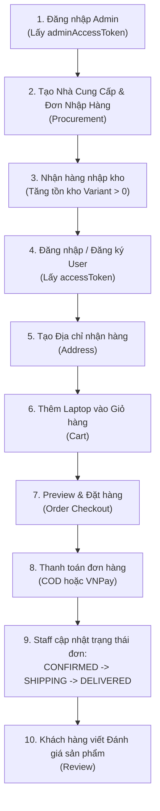

# Hướng dẫn sử dụng Postman Collection — LaptopStore API

Bộ sưu tập Postman này chứa **99 API requests** bao phủ toàn bộ 13 phân hệ chức năng của hệ thống **LaptopStore (B2C E-Commerce Monolith)**.

---

## 1. Danh sách file trong thư mục `postman/`

1. **`LaptopStore.postman_collection.json`**: File chứa toàn bộ 99 endpoint phân loại theo 13 folder nghiệp vụ, kèm Test Script tự động gán token, lưu ID, và header Idempotency-Key.
2. **`LaptopStore.postman_environment.json`**: Môi trường Local Dev (`baseUrl`: `http://localhost:8081`), định nghĩa sẵn các biến toàn cục cho quá trình test.
3. **`README.md`**: File hướng dẫn chi tiết cách import và kịch bản test luồng (file này).

---

## 2. Cách Import vào Postman

1. Mở ứng dụng **Postman** (Desktop hoặc Web).
2. Nhấn nút **Import** (ở góc trên bên trái giao diện Postman).
3. Chọn cả 2 file:
   - `postman/LaptopStore.postman_collection.json`
   - `postman/LaptopStore.postman_environment.json`
4. Ở góc trên bên phải giao diện Postman, tại mục chọn Environment, chọn: **`LaptopStore - Local Dev`**.

---

## 3. Cấu trúc 13 Thư mục Nghiệp vụ

| # | Thư mục | Số API | Quyền hạn (Role) | Mô tả chính |
|---|---|:---:|---|---|
| **00** | **System & Health Check** | 2 | Public (Không cần Token) | **Ping API (Liveness Probe)** kiểm tra server sống/chết & **Health Check (Readiness Probe)** kiểm tra kết nối Database PostgreSQL và thời gian Uptime. |
| **01** | **Authentication** | 5 | Public | Đăng ký, Đăng nhập (Admin/User), Refresh token cookie, Logout. *Tự động lưu Token vào biến môi trường*. |
| **02** | **User & Profile** | 10 | USER / ADMIN | Quản lý Profile cá nhân, sổ địa chỉ nhận hàng (CRUD Address), Admin quản lý danh sách user, phân quyền role, khóa tài khoản. |
| **03** | **Catalog - Public** | 9 | Public (Không cần Token) | Khách vãng lai xem thương hiệu, danh mục, chi tiết laptop, lọc tìm kiếm phân trang (`/search`), ảnh và thông số kỹ thuật. |
| **04** | **Catalog - Admin** | 16 | ADMIN | Quản trị viên thêm/sửa/xóa Brand, Category, Product gốc và biến thể cấu hình SKU (Màu sắc, RAM, Ổ cứng, Giá bán). |
| **05** | **Cart** | 5 | USER | Xem giỏ hàng, thêm sản phẩm vào giỏ, cập nhật số lượng, xóa từng món, dọn sạch giỏ hàng. |
| **06** | **Order & Checkout** | 8 | USER / STAFF / ADMIN | Xem trước tính tiền checkout (Preview), Đặt hàng từ giỏ (có chống trùng lặp `Idempotency-Key`), hủy đơn, Staff duyệt trạng thái đơn theo State Machine. |
| **07** | **Payment & VNPay** | 9 | USER / STAFF / ADMIN | Khởi tạo thanh toán COD / VNPay, tạo URL chuyển hướng VNPay Sandbox, xác nhận thu tiền COD, mô phỏng IPN và Return URL, tra cứu giao dịch. |
| **08** | **Promotion & Coupons** | 12 | USER / ADMIN | Admin tạo mã giảm giá (FIXED/PERCENTAGE), bật/tắt/xóa coupon, User ướm thử coupon, kiểm tra lượt dùng (CouponUsage), giải phóng lượt dùng khi hủy đơn. |
| **09** | **Inventory** | 4 | STAFF / ADMIN | Sổ cái biến động kho toàn hệ thống (`movements`), lịch sử xuất nhập tồn của từng biến thể, cảnh báo tồn kho thấp (`low-stock`), điều chỉnh kho thủ công. |
| **10** | **Procurement (Nhập hàng)** | 10 | STAFF / ADMIN | Quản lý nhà cung cấp (Suppliers), tạo phiếu đặt hàng (Purchase Orders), xác nhận nhận hàng nhập kho thực tế (tự động tăng tồn kho). |
| **11** | **Reviews** | 8 | Public / USER / STAFF | Khách xem đánh giá và tóm tắt sao (Public), User đánh giá sản phẩm sau khi đơn đã giao (DELIVERED), sửa đánh giá, Staff kiểm duyệt ẩn/hiện review. |
| **12** | **AI Assistant** | 1 | Public | Chatbot tư vấn cấu hình laptop thông minh dựa trên Google Gemini API. |

---

## 4. Cơ chế Tự động hóa Cao cấp (Auto-Healing & Chaining)

Bộ sưu tập được thiết lập sẵn **Postman Scripts** hiện đại:

1. **Tự động chuẩn hóa URL (Auto-Healing & Anti-Duplication):**
   - Đã tích hợp sẵn **Pre-request Script cấp Collection**: Tự động phát hiện và triệt tiêu lỗi lặp `/api/v1/api/v1` nếu môi trường Postman của bạn vô tình chứa sẵn đuôi `/api/v1`.
   - **Tương thích 100%:** Dù bạn chọn môi trường nào (`LaptopStore - Local Dev`, `BrewLite`, hay `No Environment`), URL gửi đi sẽ luôn được chuẩn hóa thành `http://localhost:8081/api/v1/...`.
2. **Lưu Token & ID kép (Dual Persistence):**
   - Đăng nhập xong, Token và các ID liên kết (`productId`, `orderId`, `addressId`,...) được tự động lưu đồng thời vào cả **Environment** lẫn **Collection Variables**.
   - Giúp bạn có thể chạy test mượt mà ngay cả khi không chọn Environment nào.
3. **Idempotency-Key chống trùng lặp:**
   - Các request đặt hàng và nhập kho tự động sinh UUID động qua biến `{{$guid}}`.

---

## 5. Kịch bản Kiểm thử End-to-End chuẩn (E2E Test Flow)

Bạn có thể chạy thử nghiệm theo luồng thực tế sau:



### Các bước thao tác nhanh:
0. **Bước 0 — Kiểm tra Server & Database sẵn sàng (Health Check):**
   - Chạy: `00. System & Health Check -> 01. Ping API (Liveness Probe)` -> Kiểm tra phản hồi `200 OK` và `{"status": "UP", "message": "pong"}`.
   - Chạy: `00. System & Health Check -> 02. Health Check (Readiness Probe & Database)` -> Kiểm tra `200 OK`, `{"status": "UP", "database": "UP"}` xác nhận kết nối PostgreSQL đã thông suốt.
1. **Bước 1 — Đăng nhập Admin:**
   Chạy request: `01. Authentication -> 02. Login - Admin` (Email: `kietadmin@gmail.com`, Pass: `password123`).
2. **Bước 2 — Nhập kho tăng tồn kho:**
   - Chạy: `10. Procurement -> 08. Staff - Create Purchase Order`
   - Chạy: `10. Procurement -> 09. Staff - Receive Purchase Order` (Tồn kho sản phẩm 1 sẽ tăng lên 20 máy).
3. **Bước 3 — Đăng ký & Đăng nhập User:**
   - Chạy: `01. Authentication -> 01. Register User`
   - Chạy: `01. Authentication -> 03. Login - Customer User`
4. **Bước 4 — Thêm giỏ hàng & Đặt hàng:**
   - Chạy: `02. User & Profile -> 04. Create New Address`
   - Chạy: `05. Cart -> 02. Add Item To Cart`
   - Chạy: `06. Order & Checkout -> 02. Create Order (Checkout from Cart)`
5. **Bước 5 — Staff duyệt đơn:**
   - Đổi `status` trong `06. Order & Checkout -> 08. Staff - Update Order Status` lần lượt sang `CONFIRMED` -> `SHIPPING` -> `DELIVERED`.
6. **Bước 6 — Viết đánh giá:**
   - Chạy: `11. Reviews -> 04. User - Create Review for Delivered Item` (Rating 5 sao).
   - Chạy: `11. Reviews -> 02. Get Product Review Summary (Public)` để xem điểm trung bình và biểu đồ phân bố sao được tính toán tự động!
7. **Bước 7 — Chat với AI tư vấn:**
   - Chạy: `12. AI Assistant -> 01. AI Chat Consultation` để nhận phản hồi từ Gemini.

---

## 6. Bảng mã lỗi chuẩn hệ thống (Error Responses)

Khi test các trường hợp lỗi (Negative Test Cases), hệ thống trả về JSON chuẩn theo cấu trúc:
```json
{
  "timestamp": "2026-11-19T00:00:00Z",
  "status": 409,
  "code": "INSUFFICIENT_STOCK",
  "message": "Sản phẩm không đủ tồn kho",
  "path": "/api/v1/me/orders",
  "traceId": "...",
  "fieldErrors": []
}
```

| HTTP Status | Error Code | Ý nghĩa |
|:---:|---|---|
| **400** | `VALIDATION_ERROR` | Request body sai định dạng hoặc thiếu các trường `@NotNull`, `@NotBlank`. |
| **401** | `UNAUTHENTICATED` | Thiếu Header Authorization hoặc Token JWT không hợp lệ / hết hạn. |
| **403** | `ACCESS_DENIED` | Tài khoản không đủ quyền (ví dụ User thường cố gọi endpoint của `/admin/**`). |
| **404** | `RESOURCE_NOT_FOUND` | Không tìm thấy ID tài nguyên (Sản phẩm, Đơn hàng, Địa chỉ...). |
| **409** | `INSUFFICIENT_STOCK` | Hết hàng hoặc tồn kho không đủ đáp ứng. |
| **409** | `INVALID_ORDER_STATE` | Chuyển trạng thái đơn vi phạm State Machine. |
| **422** | `COUPON_NOT_APPLICABLE` | Mã giảm giá chưa tới ngày, đã hết hạn hoặc không đủ giá trị đơn tối thiểu. |
